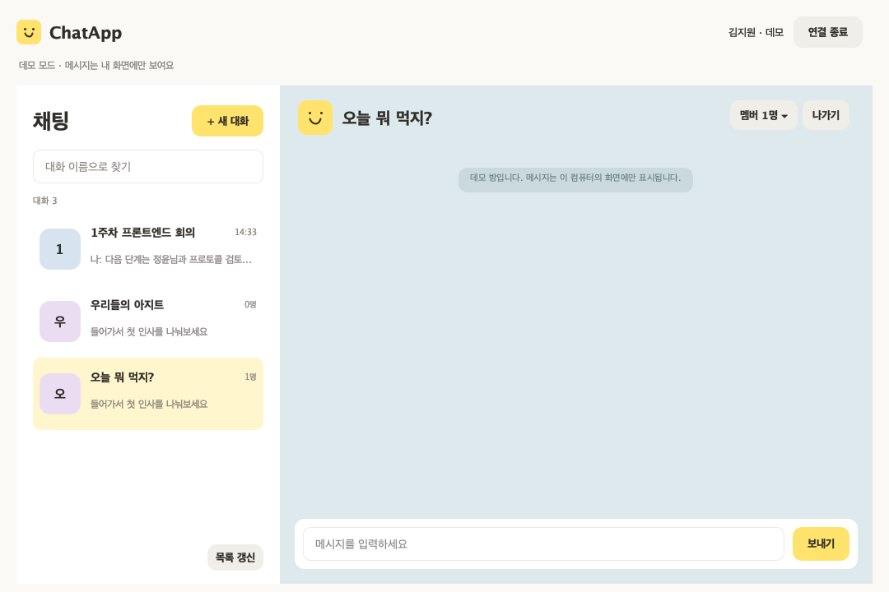

# ChatApp

**대화하고, 함께 놀고, 약속을 잡는 Java 채팅 앱**

네트워크프로그래밍 [A] 13조 팀프로젝트입니다. Java TCP 소켓과 Swing으로 채팅 앱을 만들고, 미니게임 승리 보상 이모티콘과 방별 일정 공유를 단계적으로 연결합니다. 멀티스레드 서버와 자체 메시지 프로토콜을 직접 설계·구현하는 것이 목표입니다.

> 프론트엔드 1주차 구현은 접속 화면, 대화방 목록, 채팅 화면과 TCP 클라이언트를 포함합니다. 로컬 데모와 테스트용 TCP 상대를 통한 검증을 마쳤으며, 실제 팀원 서버와의 통합은 확인 전입니다. 게임·보상·일정은 개발 예정 기능입니다.

## 화면 미리보기



로컬 데모를 자동 UI 검사에서 렌더링한 화면입니다. 현재 열린 방만 강조하며, 왼쪽 목록에서 다른 방으로 이동할 수 있습니다. 실제 다중 사용자 통신 결과는 아닙니다.

## 기능과 진행 상태

| 영역 | 내용 | 현재 상태 |
| --- | --- | --- |
| 접속 | 닉네임·서버 주소·포트 입력, 접속 실패와 연결 종료 안내 | 클라이언트 구현, 로컬 검사 완료 |
| 채팅방 | 목록·검색·생성·입장·퇴장, 참가자 목록 | 화면·요청 처리 구현, 서버 통합 확인 예정 |
| 대화 | 좌우 말풍선, 연속 메시지 묶음, 최근 대화 정렬 | 클라이언트 구현, 로컬 검사 완료 |
| 입력과 스크롤 | 방별 미전송 초안, 이전 대화 읽기 위치 유지, 새 메시지 이동 | 클라이언트 구현, 로컬 검사 완료 |
| 귓속말 | 사용자 간 개별 메시지 | 2주차 예정 |
| 미니게임·보상 | 서버 승패 판정, 승자 이모티콘 지급·사용 | 2주차 예정 |
| 일정 공유 | 방별 일정 등록·조회·수정·삭제와 변경 공유 | 3주차 예정 |

미니게임은 **2인 가위바위보 1종을 우선 검토**합니다. 게임 종류, 무승부·시간 초과·퇴장 처리와 보상 기준은 팀 협의로 확정합니다. 게임·이모티콘·일정 버튼은 현재 비활성 상태입니다.

### 현재 클라이언트의 동작 범위

- 방을 전환할 때 기존 방의 퇴장 응답을 확인한 뒤 새 방 입장을 요청합니다.
- 서버의 `CHAT_MESSAGE` 응답을 받은 메시지를 화면에 표시합니다.
- 마지막 메시지·표시 시각은 이번 접속에서 수신한 내용입니다. 시각은 클라이언트 수신 시각이며 서버의 과거 대화 내역이 아닙니다.
- 대화 화면은 최근 300개 메시지까지 표시합니다. 우클릭으로 표시 중인 대화 내용을 복사할 수 있습니다.
- 미전송 초안은 방별로 보관하며 목록에 `[작성 중]`으로 표시합니다. 연결 종료·앱 종료 시 초안은 지워집니다.
- 방별 과거 대화 저장·복원은 현재 제공하지 않습니다. 서버 저장 범위는 공동으로 결정합니다.

## 팀과 역할

| 담당 | 역할 | 주요 범위 |
| --- | --- | --- |
| 김지원 | 프론트엔드 | Swing 화면, 클라이언트 소켓 송수신, 입력 검사, 응답에 따른 화면 갱신 |
| 이정윤 | 백엔드 | Java TCP 서버, 클라이언트 스레드, 방·게임·일정 관리, 요청 검증과 데이터 저장 |
| 공동 | 설계·통합 | 프로토콜과 공통 코드 검토, 통합 테스트, 실행 안내·발표 자료 |

역할 분담은 프론트엔드·백엔드 개정 계획서를 기준으로 합니다.

## 개발 환경과 구조

- **언어:** Java, JDK 17 이상 (`java`와 `javac` 필요)
- **화면:** Java Swing, Java2D
- **통신:** TCP Socket, 입출력 스트림, 자체 메시지 프레임
- **빌드:** 셸·PowerShell 스크립트, 외부 라이브러리 및 Maven·Gradle 불필요
- **검증 환경:** JDK 25에서 `--release 17`로 컴파일 및 로컬 검사. 실제 JDK 17·Windows 실행은 별도 확인 필요

```text
src/
├── main/java/chatapp/
│   ├── client/
│   │   ├── ClientMain.java       # 클라이언트 시작점
│   │   ├── ui/                  # 화면, 테마, 말풍선과 스크롤
│   │   └── network/             # TCP 통신 및 로컬 데모
│   └── common/                  # 공동 메시지 프레임
└── test/java/chatapp/
    └── FrontendChecks.java      # UI·프레임·TCP 자동 검사
docs/                            # 프로토콜, 연결 안내, 체크리스트
개발문서/                         # 제안서, 계획서, 개인 보고서
build.sh / run.sh / test.sh       # macOS·Linux 스크립트
run.ps1                          # Windows 클라이언트 실행 스크립트
```

백엔드 코드는 추후 `src/main/java/chatapp/server/` 아래에 추가할 예정입니다. 서버 실행 클래스와 실행 명령은 통합 시 문서화합니다.

클라이언트는 하나의 TCP 연결을 공유합니다. 소켓 수신은 별도 스레드에서 수행하고, 화면 변경은 `SwingUtilities.invokeLater`로 Swing 이벤트 처리 스레드(EDT)에 전달합니다. `ChatTransport` 인터페이스를 통해 실제 TCP 통신과 로컬 데모를 구분합니다.

## 실행 방법

프론트엔드 1주차 작업 브랜치를 내려받아 확인하려면 아래 명령으로 준비한 뒤 **저장소 루트 폴더**에서 실행합니다.

```sh
git clone --branch feature/frontend-week1 https://github.com/Kim-Ji-Won/ChatApp.git
cd ChatApp
```

이미 저장소가 있다면 미커밋 작업을 먼저 정리한 뒤 `git fetch origin`과 `git switch feature/frontend-week1`로 이동합니다. 팀원끼리 개인 컴퓨터의 폴더 경로까지 맞출 필요는 없습니다.

### macOS 또는 Linux

```sh
java -version
javac -version
sh run.sh
```

### Windows PowerShell

```powershell
java -version
javac -version
.\run.ps1
```

실행 스크립트는 소스를 컴파일한 뒤 클라이언트를 시작합니다. Swing 창을 열 수 있는 데스크톱 환경이 필요합니다.

### 서버 없이 화면 확인

1. 앱을 실행하고 닉네임을 입력합니다.
2. **먼저 둘러보기**를 선택합니다.
3. 대화방 생성·입장·메시지 전송·방 전환을 확인합니다.

데모는 이 컴퓨터의 화면에서만 동작합니다. 여러 앱을 실행해도 서로 메시지를 주고받지 않으며, 데이터를 서버에 저장하지 않습니다.

### 실제 서버 연결

1. 백엔드 담당자와 [프로토콜 초안](docs/protocol.md), 서버 실행 방법, IP·포트를 확정합니다.
2. 서버를 실행한 뒤 클라이언트에 닉네임·서버 주소·포트를 입력합니다.
3. **서버 연결**을 선택하고 접속 → 방 목록 → 입장 → 채팅 → 퇴장 순서로 확인합니다.

`127.0.0.1`은 자기 컴퓨터입니다. 다른 PC의 서버에는 해당 PC의 접근 가능한 IP를 사용합니다. 기본 포트 `5000`은 제안값이며 서버 설정과 맞춰야 합니다.

## 테스트

macOS·Linux 또는 Java를 사용할 수 있는 호환 셸에서 실행합니다.

```sh
sh build.sh   # Java 17 대상 컴파일
sh test.sh    # 빌드와 자동 검사
```

자동 검사는 실제 창 없이 UI 상태를 확인하고, 로컬 임시 포트를 열어 테스트용 TCP 상대와 송수신합니다. 로컬 소켓 사용이 가능한 환경이 필요합니다. PowerShell 전용 테스트 스크립트는 아직 없습니다.

검사 범위는 입력 검증, 한글·분할·연속 프레임 수신, 방 전환 순서와 거부 응답, 초안 복원, 메시지 정렬, 스크롤 유지, 연결 종료 처리입니다. 화면 이미지는 `build/screenshots/`에 생성됩니다.

선택 표시 수정본 검증에서는 **82개 검사 통과**를 확인했습니다. 테스트용 TCP 상대는 정해진 응답을 제공하는 검사용 코드이며 운영 서버가 아닙니다. 실제 백엔드 통합 완료 여부는 [1주차 체크리스트](docs/week1-checklist.md)의 공동 확인 항목으로 판단합니다.

## 4주 개발 계획

| 주차 | 프론트엔드 | 백엔드 | 공동 완료 기준 |
| --- | --- | --- | --- |
| 1주차 | 접속·로비·채팅 화면, 소켓 송수신 | 서버·스레드, 닉네임·방·참가자 관리 | 클라이언트 3개, 방 2개 메시지 분리와 접속 종료 반영 |
| 2주차 | 게임·이모티콘·귓속말 UI | 게임 판정, 보상 검증, 귓속말 전달 | 승자가 보상을 한 번 받고 채팅에서 사용 |
| 3주차 | 일정 CRUD 화면과 입력 검사 | 일정 권한·변경 공유, 합의한 저장·복원 | 같은 방의 일정 동기화와 다른 방 데이터 분리 |
| 4주차 | 화면 오류 수정, 시연 흐름 정리 | 동시접속·비정상 종료 검증, 로그·실행 설정 | 다른 PC에서 전체 시연, 실행 안내·발표 자료·영상 완성 |

현재 진행 상태는 **프론트엔드 1주차 구현 완료, 실제 서버 통합 확인 대기**입니다. 일정은 수업 제출일과 팀 진행 상황에 맞춰 조정합니다.

## Git 협업 규칙

- `main`은 실행이 확인된 통합 버전으로 유지합니다. 직접 작업하지 않고 기능 브랜치와 PR을 사용합니다.
- 현재 프론트엔드 작업 브랜치는 `feature/frontend-week1`입니다. 백엔드 작업 브랜치는 `feature/backend-week1`입니다.
- 작업 순서는 **최신 main 확인 → 기능 브랜치 → 개발·동작 확인 → 커밋·푸시 → PR → 상대방 검토 → main 병합 → 함께 실행 확인**입니다. 병합한 기능 브랜치는 정리합니다.
- 프론트엔드와 백엔드 구현은 각 기능 브랜치에서 검토하며, 상대방의 PR 검토와 통합 확인을 거쳐 `main`에 병합합니다.
- `common/`과 `docs/protocol.md` 변경은 먼저 공유하고 양쪽에서 검토합니다.
- 커밋은 변경 단위로 작성합니다. 예: `feat: 채팅방 입장 기능 추가`, `fix: 대화방 선택 강조 중복 수정`.
- PR에는 변경 내용, 확인 방법·결과, 통신 규칙 변경, 남은 작업을 적습니다.
- GitHub Issue에 담당자와 완료 조건을 적고, 주차 말에는 서버 1개와 클라이언트 2~3개로 통합 확인합니다.
- 빌드 결과, 개인 IDE 설정, 로그·사용자 데이터는 `.gitignore`로 제외합니다.

## 관련 문서

- [메시지 프로토콜 초안](docs/protocol.md) — 메시지 형식·필드·응답·오류 규칙
- [프론트엔드 연결 안내](docs/frontend-handoff.md) — 담당 경계와 첫 서버 연결 순서
- [1주차 체크리스트](docs/week1-checklist.md) — 로컬 확인과 공동 통합 확인 구분
- [개발 문서 모음](개발문서/) — 프로젝트 제안서, 개정 계획서, Git 협업 계획, 개인 주간보고서

기존 Git 계획 PDF의 기능별 담당·`codex/` 브랜치는 초기 예시입니다. 역할은 개정 계획서의 프론트엔드·백엔드 분담을 따르며, 프론트엔드 브랜치는 이후 결정한 `feature/frontend-week1`을 사용합니다.
